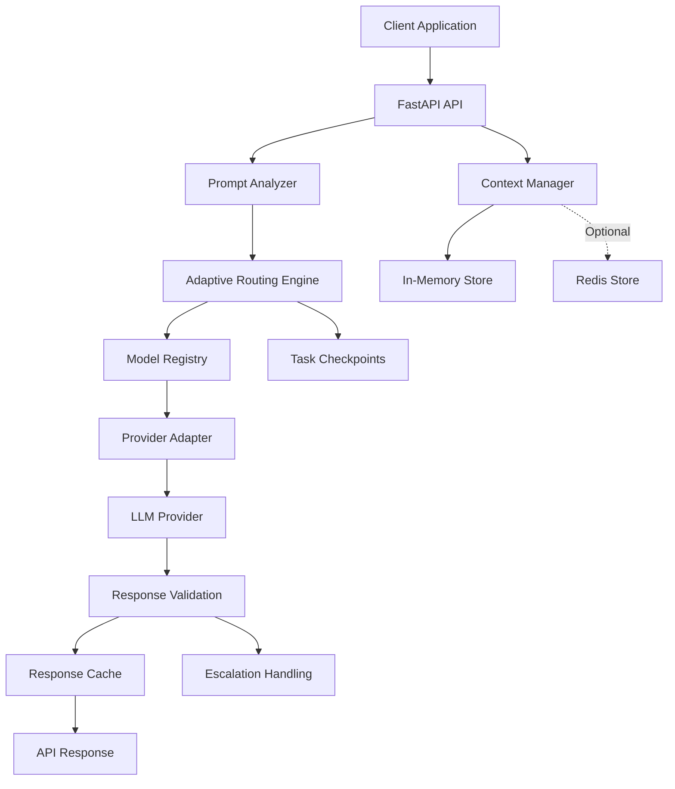

# 🚀 Adaptive LLM Orchestrator

### Intelligent Model Routing • Context-Aware Conversations • Smart Response Caching

**Adaptive LLM Orchestrator** is an intelligent AI orchestration system designed to make LLM-powered applications more efficient, flexible, and cost-conscious.

Instead of treating every prompt the same way, the system analyzes incoming requests, evaluates their complexity and task type, selects an available model according to routing policies, and reuses validated responses through intelligent caching.

It also provides conversation context management, optional Redis-backed storage, provider adapters, response validation, and fallback handling.

---

## 🌟 Project Overview

Modern AI applications often face several challenges:

- Choosing an appropriate LLM for different tasks.
- Avoiding unnecessary model calls.
- Managing conversation context across requests.
- Handling provider or model availability issues.
- Reducing repeated computation and token consumption.
- Maintaining reliable AI responses.

Adaptive LLM Orchestrator addresses these challenges through a modular orchestration layer between applications and language models.

### Our Core Idea

**Analyze → Route → Execute → Validate → Cache → Reuse**

The orchestrator evaluates each incoming request and coordinates the appropriate execution path.

---

## ✨ Key Features

### 1. Intelligent Prompt Analysis

The system analyzes incoming prompts to determine characteristics such as:

- Prompt complexity.
- Task classification.
- Context requirements.
- Suitable model tier.

This information helps the routing engine make model-selection decisions.

### 2. Adaptive Model Routing

The routing engine selects an available model based on the analyzed request and configured model availability.

Key capabilities:

- Lightweight model routing.
- Advanced-tier preference where available.
- Model selection based on task characteristics.
- Fallback to an available model when a preferred candidate is unavailable.

The actual selected model depends on configured providers and available model candidates.

### 3. Smart Response Caching

One of the key optimization features is deterministic response caching.

When a successful, validated response is generated, the system can store it for reuse.

**Cache MISS:**

- A new request arrives.
- No matching cached response exists.
- The model generates a response.
- The successful response is stored.

**Cache HIT:**

- An identical eligible request arrives again.
- The cache identifies the matching response.
- The stored response is returned without another model generation.

Cache keys account for the relevant request, model, context, and generation settings to avoid inappropriate reuse.

Cache configuration:

| Setting          | Default                                    |
| ---------------- | ------------------------------------------ |
| Response caching | Enabled                                    |
| Cache TTL        | 3600 seconds                               |
| Cache backend    | In-memory or optional Redis-backed storage |

The API also exposes cache metadata, including cache status and estimated saved tokens.

### 4. Conversation Context and AI Memory

The orchestrator supports session-based conversation context through a `context_id`.

This allows follow-up requests to reuse previously stored conversation turns.

For example:

First request:

```json
{
  "prompt": "My project is called Project Phoenix.",
  "context_id": "demo-session"
}
```

Follow-up request:

```json
{
  "prompt": "What is the name of my project?",
  "context_id": "demo-session"
}
```

The context manager makes previous conversation information available to the provider adapter.

### 5. Optional Redis-Backed Persistent Memory

The project includes an optional Redis context-store implementation.

Redis can be used for:

- Conversation context storage.
- Task checkpoint storage.
- Response cache storage.
- TTL-based data expiration.
- Reusing context across application instances when they share the same Redis backend.

Configuration:

```env
USE_REDIS=true
REDIS_URL=redis://localhost:6379/0
CONTEXT_TTL_SECONDS=86400
RESPONSE_CACHE_ENABLED=true
RESPONSE_CACHE_TTL_SECONDS=3600
```

When Redis is disabled, the application uses an in-memory context store.

The Redis implementation also includes an in-memory fallback if Redis initialization fails.

**Deployment note:** Redis persistence requires a reachable Redis server and valid configuration. The currently verified demo uses the in-memory backend; persistent Redis operation requires separate environment configuration and runtime verification.

### 6. Response Validation and Escalation

The system includes response-validation logic to evaluate generated responses.

It exposes validation metadata and supports escalation handling when a response requires additional processing.

### 7. Task Checkpoints

The orchestration engine supports task checkpoint states, including:

- Started
- Executing
- Escalated
- Completed
- Failed

This provides a foundation for tracking task execution and handling repeated task requests.

### 8. Modular Provider Architecture

The project includes provider adapter architecture for:

- Google Gemini
- OpenAI
- Anthropic

Provider execution depends on valid API credentials and configuration.

The currently verified live demo uses Google Gemini. Other provider adapters are present in the project, but simultaneous live multi-provider execution has not been verified in the current demo.

### 9. API and Observability

The application provides:

- FastAPI REST endpoints.
- Interactive Swagger documentation.
- Structured logging.
- Routing metadata.
- Cache metadata.
- Context backend information.
- Execution and validation information.

---

## 🏗️ System Architecture



### Request Lifecycle

1. Client submits a prompt.
2. FastAPI validates the request.
3. Context manager retrieves relevant session history.
4. Prompt analyzer evaluates the request.
5. Routing engine selects an available model candidate.
6. Cache checks for an eligible existing response.
7. On a cache miss, the provider executes the request.
8. Response validation evaluates the output.
9. Successful validated responses can be cached.
10. The API returns the response and execution metadata.

---

## 🛠️ Technology Stack

| Technology        | Purpose                                       |
| ----------------- | --------------------------------------------- |
| Python            | Backend development                           |
| FastAPI           | REST API                                      |
| Pydantic          | Configuration and data validation             |
| Google Gemini     | Currently verified LLM provider               |
| Redis             | Optional persistent context and cache backend |
| In-memory storage | Local context and cache fallback              |
| Pytest            | Automated testing                             |
| Uvicorn           | ASGI application server                       |

---

## 📁 Project Structure

```text
adaptive-orchestrator/
│
├── app/
│   ├── api/
│   │   ├── routes.py
│   │   ├── schemas.py
│   │   └── dependencies.py
│   │
│   ├── core/
│   │   ├── config.py
│   │   └── context.py
│   │
│   ├── orchestrator/
│   │   └── engine.py
│   │
│   ├── providers/
│   │   └── base.py
│   │
│   └── main.py
│
├── tests/
│
├── .env.example
├── requirements.txt
└── README.md
```

---

## 🚀 Getting Started

### Prerequisites

- Python 3.10 or newer, compatible with project dependencies.
- pip
- Google Gemini API key for the currently configured live provider.
- Optional Redis server for persistent context storage.

### 1. Clone the repository

```bash
git clone https://github.com/kumarakshu/adaptive-orchestrator.git
cd adaptive-orchestrator
```

### 2. Create a virtual environment

Windows PowerShell:

```powershell
python -m venv .venv
.\.venv\Scripts\Activate.ps1
```

Linux/macOS:

```bash
python -m venv .venv
source .venv/bin/activate
```

### 3. Install dependencies

```bash
pip install -r requirements.txt
```

### 4. Configure environment variables

Create a `.env` file in the project root.

Configure the Gemini API credential using the environment variable name expected by the provider configuration.

Optional Redis and cache settings:

```env
USE_REDIS=false
REDIS_URL=redis://localhost:6379/0
CONTEXT_TTL_SECONDS=86400
RESPONSE_CACHE_ENABLED=true
RESPONSE_CACHE_TTL_SECONDS=3600
```

Keep API keys and credentials private. Never commit your actual `.env` file.

### 5. Start the application

```bash
python -m uvicorn app.main:app --reload
```

The local application will be available at:

http://127.0.0.1:8000

Interactive API documentation:

http://127.0.0.1:8000/docs

---

## 🧪 API Usage

### Endpoint

```http
POST /api/v1/chat
```

### Example request

```json
{
  "prompt": "Explain what an API is in simple terms."
}
```

### Example response fields

```json
{
  "success": true,
  "content": "An API allows different software applications to communicate.",
  "selected_model": "gemini-3.8-flash",
  "selected_tier": "lightweight",
  "complexity": "simple",
  "task_type": "other",
  "cached": false,
  "cache_status": "MISS",
  "context_backend": "in_memory",
  "context_turns_used": 0,
  "cache_saved_tokens": 0
}
```

Actual model selection, response content, and metadata depend on runtime configuration and the request.

---

## 📊 Demonstrated Results

The following results were verified during the current development demo:

| Test                          | Observed result |
| ----------------------------- | --------------- |
| Simple prompt execution       | HTTP 200        |
| Complex prompt classification | Verified        |
| Preferred-tier fallback       | Verified        |
| First identical request       | Cache MISS      |
| Second identical request      | Cache HIT       |
| Reported saved tokens         | 360             |
| Context backend               | in_memory       |
| Automated test suite          | 149 passed      |

The reported 360 saved tokens are the application's estimated cache-saving metadata, not an independently measured billing reduction.

---

## 🧪 Running Tests

Run the automated test suite:

```bash
python -m pytest -q
```

Latest verified development result:

```text
149 passed
```

---

## 🌐 Live Demo

**Production API:**

https://adaptive-orchestrator.onrender.com

**Swagger Documentation:**

https://adaptive-orchestrator.onrender.com/docs

The deployed service uses the currently configured Gemini provider. Free hosting services may spin down after inactivity, so the first request can take longer.

---

## 🔮 Future Roadmap

Potential improvements include:

- Fully verified Redis-backed persistent conversation memory.
- Shared context across multiple application instances.
- Live multi-provider routing and failover.
- Advanced semantic caching.
- More accurate token-usage and cost tracking.
- Improved routing policies using historical performance.
- Distributed task execution.
- Dashboard for latency, cache hit rate, and model usage.
- More extensive load and reliability testing.

---

## 💡 Why This Project?

Adaptive LLM Orchestrator explores a practical approach to building more efficient AI applications.

By combining intelligent routing, reusable context, optional persistent storage, and response caching, the project aims to reduce unnecessary model execution and make AI orchestration more adaptable.

**The goal is simple: Use the right available model, preserve useful context, and avoid repeating work unnecessarily.**

---

## 👨‍💻 Author

**Akash Kumar**

GitHub: https://github.com/kumarakshu

---

## 📜 License

Add an appropriate open-source license before distributing the project for reuse.
